<p align="center">
  
</p>

<p align="center">
  
  
  
  
</p>

Структурированный архив разборов и лабораторных работ по **компьютерной экспертизе (DFIR)**, **расследованию инцидентов (Incident Response)**, **реверс-инжинирингу**, **OSINT** и **Web CTF**.

> Практические кейсы с **Hack The Box (Sherlocks)**, **TryHackMe**, лабораторные работы **РТУ МИРЭА** и CTF-площадок.

---

## [01] DFIR & Incident Response (Компьютерная экспертиза)

| Кейс | Платформа | Артефакты и инструменты |
| :--- | :--- | :--- |
| [Operation Dream Job-2 (APT Lazarus)](./dfir-ir/htb-sherlocks/dream-job-2-lazarus.md) | HTB Sherlocks | MITRE ATT&amp;CK, `isoinfo`, `exiftool`, `pescan`, `olevba`, `pcode2code`, VBA Stomping |
| [RomCom — WinRAR `CVE-2025-8088`](./dfir-ir/htb-sherlocks/romcom-winrar-cve-2025-8088.md) | HTB Sherlocks | EZ Tools (`MFTECmd`, `Timeline Explorer`), NTFS `$MFT` &amp; `$J`, `ObjectIdChange`, `T1547.009` |
| [Operation Blackout 2025: Smoke &amp; Mirrors](./dfir-ir/htb-sherlocks/operation-blackout-smoke-and-mirrors.md) | HTB Sherlocks | Defense Evasion, LSA Registry, `Set-MpPreference`, AMSI (`AmsiScanBuffer`), `bcdedit` |
| [Operation Blackout 2025 — Anti-VM Checks](./dfir-ir/htb-sherlocks/operation-blackout-anti-vm.md) | HTB Sherlocks | PowerShell `.evtx` (Event ID `4104`, `800`), WMI, Nishang `Check-VM` |
| [PhishNet — Анализ фишингового `.eml`](./dfir-ir/htb-sherlocks/phishnet-email-analysis.md) | HTB Sherlocks | Email Headers, SPF, Base64/ZIP (`7z`), `sha256sum`, `T1566.001` |
| [Лаба №1: Инцидент на Windows Server](./dfir-ir/university-mirea/lab-01-windows-server-incident.md) | РТУ МИРЭА | Журналы `System` (Event ID `7045`) и `Security` (Logon, привилегии, SID) |
| [Duckerz — DoS-логи веб-сервера](./dfir-ir/ctf-forensics/duckerz-dos-logs/writeup.md) | Duckerz CTF | Анализ HTTP-логов во время DoS-атаки |

---

## [02] Reverse Engineering

| Задача | Платформа | Техники и инструменты |
| :--- | :--- | :--- |
| [Crypt of the Undead](./reverse-engineering/htb/crypt-of-the-undead.md) | Hack The Box | Декомпиляция ELF в **IDA Pro (`F5`)**, обход проверки `.undead` |
| [FlagCasino](./reverse-engineering/htb/flag-casino.md) | Hack The Box | IDA Pro, предсказуемый `srand()`/`rand()`, авторешатель на Python (`ctypes` + `pwntools`) |

---

## [03] OSINT & Social Engineering

| Материал | Формат | Тематика |
| :--- | :--- | :--- |
| [Кейс Social Engineering &amp; Phishing Analysis](./osint/README.md) | Обзор + [PDF-отчёт](./osint/osint-report.pdf) | Фишинговая кампания под видом «Госуслуг», редиректы, Sandbox-анализ панели, IOCs |

---

## [04] Web Security & CTF

| Задача | Платформа | Вектор / Техника |
| :--- | :--- | :--- |
| [HTML Injection](./web-security/tryhackme/html-injection/writeup.md) | TryHackMe | HTML Injection &amp; анализ клиентского JS (`decodeBase64`) |
| [Donut Design](./web-security/mirea-ctf-school/donut-source-review/writeup.md) | МИРЭА CTF School | Source Code Review (`/script.js`) |
| [AdminBrowser](./web-security/mirea-ctf-school/specbrowser-user-agent/writeup.md) | МИРЭА CTF School | User-Agent Spoofing в DevTools |
| [Cookie Admin](./web-security/mirea-ctf-school/testadmin-cookies/writeup.md) | МИРЭА CTF School | Cookie Tampering (`is_admin=true`) |
| [Flappy Bird](./web-security/duckerz-ctf/flappy-bird-js/writeup.md) | Duckerz CTF | Манипуляция JS-объектом `UI.score.curr` и вызов `getFlag()` |
| [Печеньки с молочком](./web-security/duckerz-ctf/cookie-milk/writeup.md) | Duckerz CTF | Подмена cookie (`username=admin`) |
| [Скрытая документация](./web-security/duckerz-ctf/secret-document-dirbusting/writeup.md) | Duckerz CTF | Directory Enumeration (`gobuster`) |
| [Розыгрыш купонов](./web-security/duckerz-ctf/sql-injection-coupons/writeup.md) | Duckerz CTF | SQL Injection (`sqlmap`) |
| [Юридический квест](./web-security/duckerz-ctf/zakon-dom-manipulation/writeup.md) | Duckerz CTF | JS DOM Manipulation (`click()`) |
| [checkFILE](./web-security/bugodelnya/checkfile-path-traversal/writeup.md) | BUGodelnya CTF | Path Traversal (`../`) |

---

## [05] Структура репозитория

```text
cybersec-writeups/
├── assets/
│   └── banner.svg
├── dfir-ir/
│   ├── htb-sherlocks/         # Расследования HTB (EVTX, $MFT/$J, Threat Intel, Email)
│   ├── university-mirea/      # Лабораторные работы РТУ МИРЭА по компьютерной экспертизе
│   └── ctf-forensics/         # Форензика на CTF
├── reverse-engineering/
│   └── htb/                   # Разборы бинарников в IDA Pro + Python/pwntools
├── osint/
│   ├── README.md
│   └── osint-report.pdf
└── web-security/
    ├── tryhackme/
    ├── mirea-ctf-school/
    ├── duckerz-ctf/
    └── bugodelnya/
```
