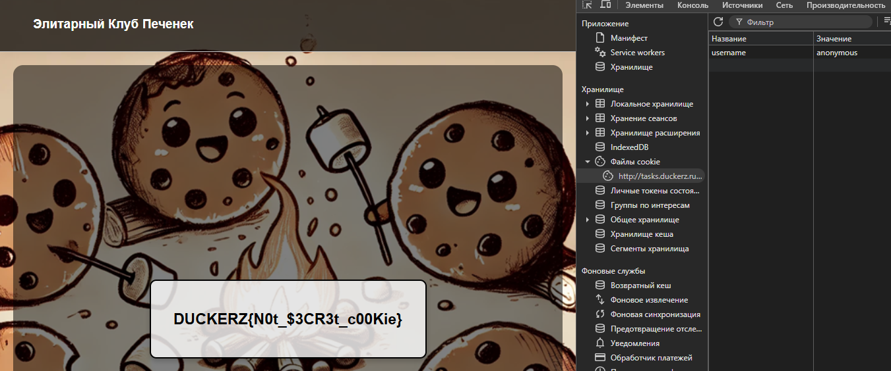

[← Назад к оглавлению](../../../README.md)

# Печеньки с молочком — Duckerz CTF

| Параметр | Значение |
| :--- | :--- |
| **Платформа** | Duckerz CTF |
| **Категория** | Web (Cookie Tampering) |

## Описание

Веб-сайт хранит текущую роль пользователя в открытом виде внутри cookie.

## Решение

1. Открываем **DevTools (`F12`) → Application → Cookies**.
2. Находим cookies: `PHPSESSID=e331b8a198ff2e60d4c4143f0f8e01ab` и `username=anonymous`.
3. Меняем значение `username` с `anonymous` на `admin`.
4. Обновляем страницу и забираем флаг.

## Скриншот

