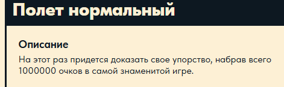
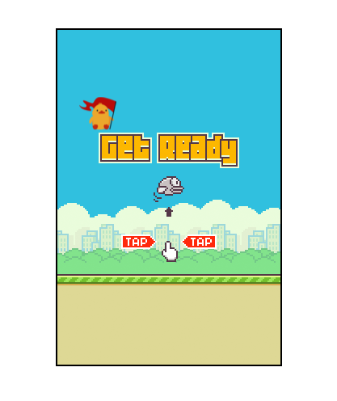
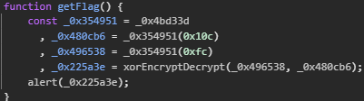
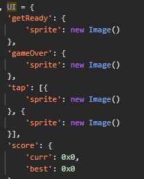
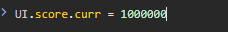
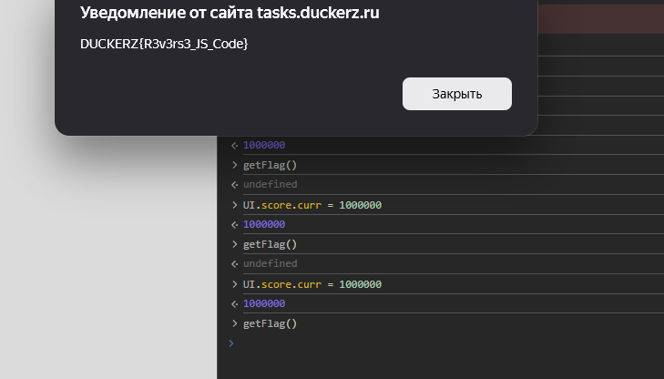

[← Назад к оглавлению](../../../README.md)

# Flappy Bird — Duckerz CTF (Манипуляция JS-состоянием)

| Параметр | Значение |
| :--- | :--- |
| **Платформа** | Duckerz CTF |
| **Категория** | Web (Client-Side JS Analysis) |

## Быстрое решение

1. Открываем консоль разработчика (`F12` → Console).
2. Выставляем счёт и сразу вызываем функцию выдачи флага (в одну команду, чтобы не сработал сброс состояния):

```js
UI.score.curr = 1000000;
getFlag();
```

---

## Подробный разбор

Условие и интерфейс игры:





Открываем DevTools (`F12`) → **Sources**, находим игровой JS-скрипт и видим функцию `getFlag()`:



Там же находим объект `UI`, внутри которого хранится текущий счёт `UI.score.curr`:



После проигрыша (не перезагружая страницу) вводим в консоль `UI.score.curr = 1000000`:



После этого вызываем `getFlag()` и получаем флаг:


