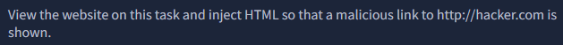
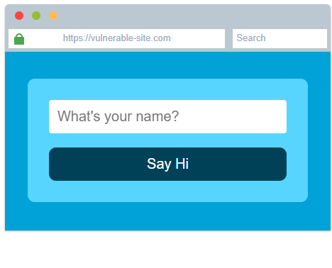
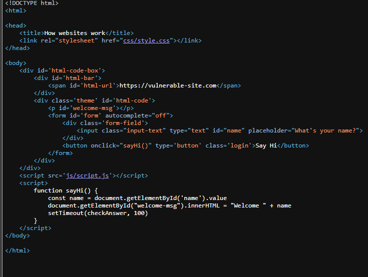
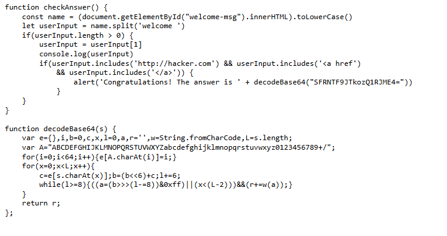
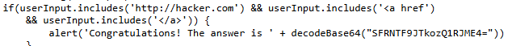
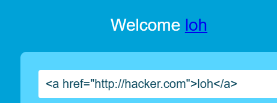

[← Назад к оглавлению](../../../README.md)

# TryHackMe — HTML Injection

| Параметр | Значение |
| :--- | :--- |
| **Платформа** | TryHackMe |
| **Категория** | Web Security (HTML Injection / Client-Side Analysis) |

## Задача



Открываем веб-страницу с полем ввода `What's your name?`:



Если ввести обычную строку (например, `loh`), на экране выведется `Welcome loh`.

---

## Анализ клиентского кода

Открываем исходный код фрейма (*«Просмотреть код фрейма»*) и находим ссылку на JS-скрипт обработки формы:



Переходим к скрипту и изучаем логику проверки ввода:



После анализа кода видны сразу два пути решения.

---

## Вариант 1: Декодирование флага из JS-кода

В конце условия проверки прописан вызов:



```js
alert('Congratulations! The answer is ' + decodeBase64("SFRNTF9JTkozQ1RJME4="))
```

Достаточно декодировать строку `SFRNTF9JTkozQ1RJME4=` из Base64 (например, в CyberChef или CLI), чтобы сразу получить флаг.

---

## Вариант 2: Классическая HTML-инъекция

В условии задачи ожидается внедрение HTML-тега ссылки `<a>` в поле ввода. Передаём payload:

```html
<a href="http://hacker.com">loh</a>
```

Вводим строку в поле имени и получаем флаг через всплывающее сообщение:


